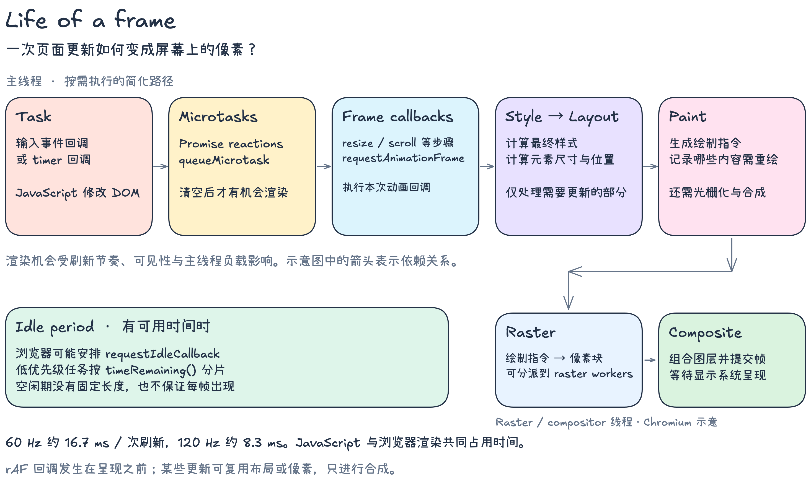

# 一次 DOM 更新何时变成屏幕上的像素<sup><code>life-of-frame</code></sup>

点击按钮后，下面的代码会修改方块的宽度。作者写入的 `200px` 先成为 DOM 上的内联样式，浏览器随后计算样式与几何信息、绘制并呈现页面。

这是一个简化的浏览器示例，可保存为 HTML 后打开。打开 DevTools Console，再点击按钮观察日志。

```html
<button id="grow">变宽</button>
<div id="box" style="width: 100px; height: 40px; background: coral"></div>

<script>
  const box = document.querySelector("#box")

  document.querySelector("#grow").addEventListener("click", () => {
    box.style.width = "200px"
    console.log("同步回调", box.style.width)

    queueMicrotask(() => {
      console.log("microtask")
    })

    requestAnimationFrame(() => {
      console.log("rAF", box.style.width)
    })
  })
</script>
```

同步回调读取的是刚写入的内联样式。接着执行排入队列的 microtask，rAF 回调在后续可用的渲染机会中执行。日志中的 `200px` 可以在像素呈现之前读取到。rAF 的执行时机由浏览器渲染调度决定。[HTML event loop 与渲染更新](https://html.spec.whatwg.org/multipage/webappapis.html#event-loop-processing-model)

本次在 Chrome 中运行该示例并点击按钮，观察到日志依次为“同步回调 200px”“microtask”“rAF 200px”。日志只验证回调顺序，像素实际呈现的时间仍需通过渲染轨迹观察。

## 1. 从 JavaScript 到屏幕



这是一张可编辑的 Excalidraw PNG，场景 JSON 内嵌在图片中。使用 VS Code 的 `pomdtr.excalidraw-editor` 打开图片可继续编辑，Markdown 预览直接显示图片。图按典型依赖顺序组织，并将 Chromium 的 raster / compositor 工作画在另一行。[Excalidraw 插件的图片编辑说明](https://github.com/excalidraw/excalidraw-vscode#edit-images)

### 1.1. 任务与微任务

输入事件回调、到期的 timer 回调都可能作为 task 执行。事件循环在一个 task 完成后执行 microtask checkpoint，处理 Promise reaction、`queueMicrotask` 等排入的微任务。执行微任务时新产生的微任务也会继续被处理，持续追加会推迟浏览器后续工作。[HTML event loop processing model](https://html.spec.whatwg.org/multipage/webappapis.html#event-loop-processing-model)

图中的 Task 表示触发此次更新的一种路径。输入与 timer 来自不同任务来源，具体选择受调度影响；一个 timer 到期后，其回调仍需等待主线程可执行。页面一次可见更新前可能已经运行了多个 task。[HTML task queues](https://html.spec.whatwg.org/multipage/webappapis.html#task-queue)

### 1.2. 渲染机会与动画帧回调

浏览器根据刷新节奏、页面可见性等条件决定渲染机会。渲染更新包含 resize、scroll、动画更新以及 animation frame callbacks 等步骤，部分步骤只有存在待处理工作时才执行。图将它们合并在同一区块，正文只跟踪示例中的 rAF 路径。[HTML update the rendering](https://html.spec.whatwg.org/multipage/webappapis.html#update-the-rendering)

`requestAnimationFrame` 注册一次回调。浏览器调用它时，脚本仍可能修改 DOM 和样式，这些修改可参与后续的样式与布局更新。连续动画通常在回调里再次注册 rAF。回调里的长计算会占用主线程，延后这一轮渲染工作。[Chrome 对动画帧与主线程工作的说明](https://developer.chrome.com/blog/inside-browser-part3/#updating-visuals)

参考图中的 blocking input 与 non-blocking input 描述的是输入处理对浏览器默认行为的影响。例如，可能取消默认滚动的 touch / wheel listener 会影响滚动调度；监听器是否 passive、是否调用 `preventDefault()` 都会改变情况。单靠事件名称无法确定它是否阻塞滚动。即使是 passive listener，其中的 JavaScript 仍会占用主线程。[Chrome passive event listeners](https://developer.chrome.com/blog/passive-event-listeners/)

### 1.3. 样式计算与布局

Style 根据 DOM、CSS 规则等计算元素的样式。Layout 根据样式及布局约束确定尺寸和位置。示例修改 `width`，可能使方块及受其影响的元素重新布局。浏览器会跟踪需要更新的部分，并复用仍然有效的结果。[Chromium rendering critical path](https://www.chromium.org/developers/the-rendering-critical-path/)

代码里的 `box.style.width` 只读取内联值。如果改为在样式写入后读取 `box.offsetWidth` 等几何信息，浏览器可能需要立即更新样式与布局来返回结果。布局因此也可能发生在 JavaScript 执行期间，先于图中的常规布局位置。[Chrome forced synchronous layout](https://web.dev/articles/avoid-large-complex-layouts-and-layout-thrashing#avoid_forced_synchronous_layouts)

### 1.4. 绘制、光栅化与合成

Paint 生成描述绘制内容的指令。Raster 将这些指令转换成像素块，Composite 组合图层并提交帧，之后由显示系统呈现。Chromium 将相关工作分配给主线程、raster workers 和 compositor 等执行单元，实际轨迹可在 DevTools 中观察。[Chrome paint、raster 与 compositing](https://developer.chrome.com/blog/inside-browser-part3/#raster_and_composite_off_of_the_main_thread)

不同更新经过的步骤不同。改变尺寸通常涉及布局；改变颜色可能只需要绘制及后续工作；满足图层和动画条件的 `transform` / `opacity` 更新可以复用像素、走合成路径。因此，读图时应结合实际失效的内容判断需要运行哪些阶段。[Chromium rendering critical path](https://www.chromium.org/developers/the-rendering-critical-path/)

## 2. 一次刷新有多少时间？

60 Hz 的刷新间隔约为 `1000 / 60 ≈ 16.7 ms`，120 Hz 约为 `8.3 ms`。JavaScript、样式、布局与后续渲染工作共同争取这段时间。主线程上的长 task 或持续的 microtask 会延迟它参与下一次画面更新，可能导致重复显示旧画面。[Chromium 对帧预算与卡顿的说明](https://www.chromium.org/developers/the-rendering-critical-path/)

图中的 Idle period 表示浏览器判断有空闲时间时可以安排的工作。`requestIdleCallback` 通过 `deadline.timeRemaining()` 提供当前预计剩余时间，回调应在预算内处理部分工作，再调度剩余部分。空闲期的出现与长度取决于浏览器调度，繁忙页面可能长期无法获得足够空闲时间。带 timeout 的回调也可能因超时被调度，此时需留意 `didTimeout`。[requestIdleCallback 规范](https://www.w3.org/TR/requestidlecallback/#idle-periods)

## 3. 在 React 源码里如何对应？

浏览器仍负责上图中的渲染流水线。React 的工作会执行 JavaScript，并在 commit 中修改宿主环境。研究调度时，可以先从本地 React 18.2.0 的 Scheduler 看“下一段 JavaScript 怎样获得执行机会”。

在 React `v18.2.0` 的 `packages/scheduler/src/forks/Scheduler.js` 中，`requestHostCallback` 保存待执行回调并安排 `performWorkUntilDeadline`；`schedulePerformWorkUntilDeadline` 根据环境选择 `setImmediate`、`MessageChannel` 或 `setTimeout`。这是通过源码阅读确认的调度路径，浏览器中的实际切片长度与呈现时机需要另行录制 Performance trace 验证。[React v18.2.0 Scheduler 实现](https://github.com/facebook/react/blob/v18.2.0/packages/scheduler/src/forks/Scheduler.js#L518-L590)
